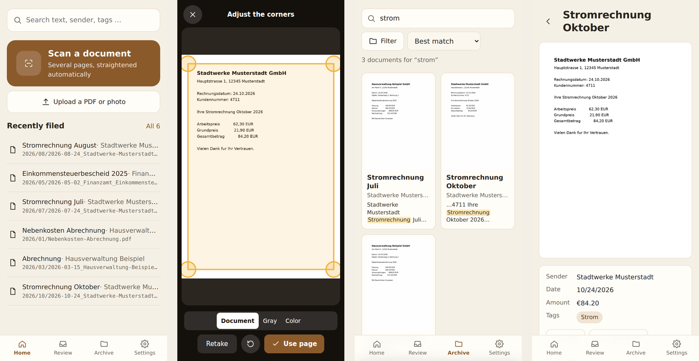
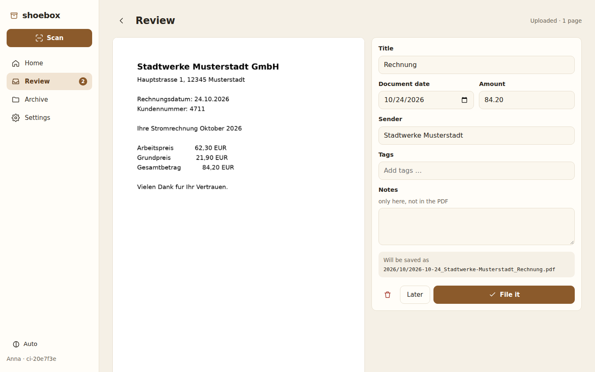
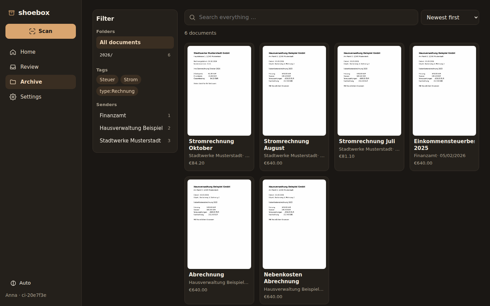
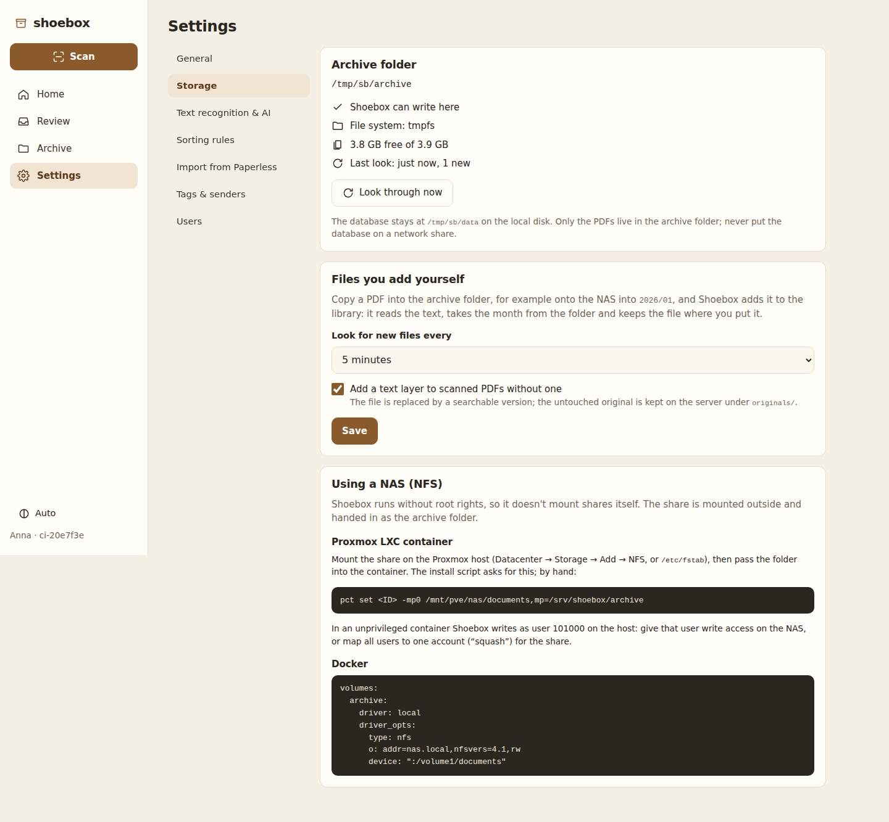

# paperless is a bit much?

**Shoebox** is a small, self-hosted archive for your letters, bills and contracts. Scan a page with your phone, Shoebox reads the text, guesses the date, sender and amount, and files the PDF into a plain folder by year and month. Then you find it again by searching for any word in it.

No Redis, no Celery, no PostgreSQL: one Go binary with a SQLite index, Tesseract for the text, and a mobile-first web app you can install on your phone's home screen.

<p></p>

<p></p>

<details>
<summary>More screens</summary>

<p></p>
<p></p>
</details>

## What it does

- **Scan with the phone, in the browser.** Live camera with page detection, drag the corners if needed, several pages per document, automatic straightening and a clean “document” look. Without HTTPS, it falls back to the phone's camera app and still straightens the photo.
- **Upload** PDFs and photos, from the phone or the desktop.
- **Text recognition** with Tesseract: every document becomes a searchable PDF. Optionally a **local AI model** (Baidu's OCR model or any vision model behind an OpenAI-compatible API such as vLLM, Ollama or llama.cpp) reads the pages too, and can suggest title, date, sender and amount.
- **Sorting on its own.** Sorting rules (any word, all words, exact text, regular expression, fuzzy for OCR typos) set the sender, tags and title. When a rule matches and a date is found, the document is filed without asking; everything else waits in **Review** with the facts already filled in.
- **It learns from your archive.** A new letter gets the tags and the sender that its most similar filed documents share. Shoebox also **suggests sorting rules**: a line that appears in every letter of one sender and in no other becomes a rule with one click.
- **Mark it on the page.** On the desktop, the pen next to a field opens the page: drag a box around the date, the amount or the sender, and Shoebox fills the field.
- **Pages afterwards.** Reorder, turn, remove or re-crop the pages of a document; the first version is kept.
- **A plain folder you own.** `archive/2026/10/2026-10-24_Stadtwerke_Stromrechnung.pdf`. Title, sender, tags and date are also written into the PDF itself, so the folder makes sense without Shoebox.
- **The folder works both ways.** Copy a PDF into the archive (for example straight onto the NAS into `2026/01`) and Shoebox adds it to the library, adds a text layer if it has none, and dates it by its folder. Files you move or delete there are followed.
- **Search** across the text, title, sender and tags, with word beginnings (`strom` finds “Stromrechnung”). Browse by year and month, tag or sender.
- **Move over from Paperless-ngx** in a few clicks: documents, tags, correspondents, document types, dates, notes, custom fields and matching rules, through its API. Paperless is only read; you can test with 50 documents and run it again.
- **Libraries you share.** Separate archives, each in its own folder (another NAS share, or a folder next to the first), with their own tags, senders and rules: a private one, one for the household, one for the company. Each is shared with chosen accounts, who can edit or only read.
- **Accounts**, **passkeys** for signing in with the phone's or computer's screen lock, and **API tokens** for scripts and network scanners.
- **Database backups** into the archive folder (the NAS) on a button press or every day.
- Tag colors, statistics for the curious, light and dark, phone and desktop (1080p and up).

## Install

### Proxmox: a new LXC container

On the Proxmox host, as root:

```bash
bash -c "$(curl -fsSL https://raw.githubusercontent.com/lcsfls/shoebox/main/deploy/proxmox/shoebox-lxc.sh)"
```

It asks for the container ID, CPU, memory, disk and network, and **where your PDFs should live**:

1. **A folder on the Proxmox host**, typically a NAS share: add it under *Datacenter → Storage → Add → NFS* first, it is mounted at `/mnt/pve/<name>`, then pick it (or a subfolder). It is passed into the container as a mount point.
2. **A new volume** on one of your Proxmox storages, with the size you choose.
3. **Inside the container disk.**

The container is unprivileged; Shoebox runs as an ordinary user and writes as user `101000` on the host. On a NAS share, let that user write (for example by mapping all users of the Proxmox host to one account for the share). At the end the script prints the address and the setup code for the first account.

### Debian or Ubuntu (VM, LXC you made yourself, small server)

```bash
curl -fsSL https://raw.githubusercontent.com/lcsfls/shoebox/main/deploy/install.sh | sudo bash
```

Updates: *Settings → Updates* shows new releases and installs them with one click (a backup first, then a restart; if the new version doesn't start, Shoebox goes back to the previous one), or every night by itself. Running the script again works too. Settings live in `/etc/shoebox.env`, logs in `journalctl -u shoebox`. Optional: `SHOEBOX_ARCHIVE=/mnt/nas/documents SHOEBOX_LANGS="deu eng fra"` in front of `bash`.

### Docker

```bash
git clone https://github.com/lcsfls/shoebox && cd shoebox
docker compose up -d --build
docker compose logs shoebox | grep "setup code"
```

`docker-compose.yml` shows how to put the archive on an NFS share.

## Good to know

- **The camera needs HTTPS.** Browsers only allow the live camera on secure pages. Put Shoebox behind your reverse proxy with a certificate (Caddy, nginx, Nginx Proxy Manager; a DNS challenge works for addresses only reachable at home), or give it a certificate with `SB_TLS_CERT` and `SB_TLS_KEY`. On plain HTTP, “Take a photo” opens the camera app instead, and Shoebox straightens that photo just the same.
- **Install it as an app:** open Shoebox on the phone, then *Add to home screen*. It opens without browser bars and starts on the scanner with a long press on the icon (Android).
- **The database stays on the local disk** (`SB_DATA`). Only the PDFs go to the archive folder, which may be a network share. SQLite on NFS is not safe.
- **Backups:** the archive folder is the important part; the PDFs carry their own title, sender, tags and date. *Settings → Storage → Back up now* (or every day) also puts a copy of the database into `archive/.shoebox-backup/`, with notes, rules, accounts and the documents waiting in Review. The same page shows how to restore it.
- **Passkeys need HTTPS** and a host name (not an IP address), like the camera.
- **Nothing is deleted right away.** Deleting a document moves the PDF into `SB_DATA/trash`. When Shoebox adds a text layer to a PDF you put into the archive, the untouched original is kept in `SB_DATA/originals`.

### A local AI model for reading

Under *Settings → Text recognition & AI*, enter the address of any OpenAI-compatible server and the model name, for example a vLLM server on a machine with a GPU:

```bash
vllm serve <model-name> --port 8000     # e.g. Baidu's OCR model from Hugging Face
```

Address: `http://gpu-box:8000/v1`. *Test connection* lists the models the server offers. Tesseract keeps making the searchable PDF; the model's text is used for search and for recognizing the facts. With *Also ask for title, date, sender and amount*, an instruction-following model fills those in (sorting rules still win).

### Moving from Paperless-ngx

*Settings → Import from Paperless*: the Paperless address and an API token (in Paperless: your profile → *API Auth Token*). *Connect and count* shows what will come over; *Test with the newest 50* imports a sample. Correspondents become senders, document types become tags like `type:Rechnung`, matching rules become sorting rules. Paperless' learned “Auto” matching can't be copied; Shoebox says how many items use it. Run the import as often as you like: documents already there are skipped.

### Settings

| Variable | Default | |
|---|---|---|
| `SB_LISTEN` | `:8080` | address and port |
| `SB_DATA` | `./data` | database, review inbox, caches, trash (local disk) |
| `SB_ARCHIVE` | `$SB_DATA/archive` | the archive folder (may be a NAS share) |
| `SB_TRUST_PROXY` | `false` | take the client address from `X-Forwarded-For` (behind a reverse proxy) |
| `SB_TLS_CERT`, `SB_TLS_KEY` | | serve HTTPS directly |

Everything else (file name pattern, review behaviour, languages, the AI model, how often the archive folder is checked) is set in the app.

## Development

```bash
cd web && npm install && npm run build && cd ..   # the app (Svelte 5, built with esbuild)
go run .                                          # needs tesseract, poppler-utils, qpdf, exiftool
go test ./...                                     # unit and integration tests (with Tesseract installed)
cd web && npm test                                # scanner math and helpers
```

CI also runs the whole thing in a browser (`e2e/`), including the camera scanner, the folder watcher and a Paperless import against a stand-in API, and keeps screenshots of every screen.

> **Built with AI.** Shoebox was written by Claude (Anthropic's AI model) in conversation with its maintainer, and tested end to end. Read the code before you trust it with important papers, keep backups, and keep it in your home network or behind a reverse proxy.

## License

[AGPL-3.0](LICENSE)
